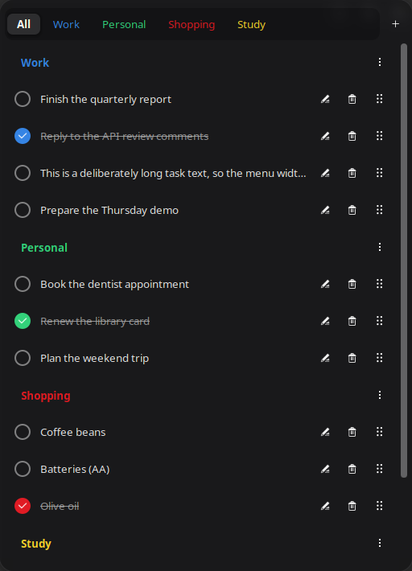

# Todo MD

A GNOME Shell todo extension that keeps your tasks in a plain **markdown
checkbox** file (`~/todo.md` by default) and shows them in the panel menu. No
database, no proprietary format, no cloud — the file stays readable in any
editor, on any device.



Supports GNOME Shell 46 through 51 on Wayland. See the
[release verification notes](docs/ego-submission.md#release-verification) for
the coverage recorded for 0.23.0. Written in JavaScript (ESModules, GJS).

> **Status (2026-11-15):** The 0.23.0 upload was awaiting review on
> extensions.gnome.org. You can install and update from GitHub Releases. See
> [Install](#install).

## Why Todo MD?

- **The file is already a todo list everywhere else.** Markdown checkboxes render
  as real checkboxes in Obsidian, VS Code, GitHub, Logseq and most note apps, so
  the same file works as a checklist with or without this extension — nothing to
  export, nothing to convert if you stop using it.
- **A flat format instead of a format with a manual.** `todo.txt` wants its own
  syntax for priority, projects and contexts (`(A)`, `+project`, `@context`) and
  a tool that speaks it; its GNOME extensions are unmaintained and pinned to
  Shell ≤ 45. Here there are two things to learn — `- [ ]` and `## Heading` — and
  any markdown editor already knows both.
- **The extension is a view, not a vault.** No sync, no import/export, no
  database. Edit the file in vim, with `sed`, in Syncthing, in git or on your
  phone: a `Gio.FileMonitor` picks the change up live and the menu refreshes.
- **Every rewrite is safe.** Notes, blank lines, comments and any other
  non-task line survive verbatim, line endings are preserved, and only three
  normalizations are deliberate (see
  [Deliberate normalizations](#deliberate-normalizations)) — so the diff after
  an action is exactly the action. The file is safe in git or in a synced
  folder.
- **Categories are structure, not decoration.** `##` headings become colored
  tabs with their own add / rename / recolor / delete actions; renaming carries
  the color over, deleting drops it, and neither touches a task line.
- **Written for the Wayland-only era, and kept alive.** GNOME 49 removed X11 and
  GNOME 50 removed it entirely, which leaves a lot of todo extensions on APIs
  that no longer exist. Todo MD is regression-tested on every Shell release it
  declares and developed in the open.
- **Tiny footprint.** One markdown file plus its own GSettings schema: no
  network requests, no daemon, no subprocesses, no clipboard use.
- **Panel-native behaviour.** A fixed menu width (the frame never jumps), a
  configurable height with scroll positions that survive every action,
  drag-and-drop ordering with Alt+Up / Alt+Down as the keyboard path, and inline
  editing without leaving the menu.

## Features

- Panel indicator with a popup menu listing the tasks from your file
- **Tabs**: a permanent, horizontally scrollable strip (`All` plus one tab per
  category) that filters the menu. The tabs carry the category color, the scroll
  position survives every rebuild, and the mouse wheel scrolls the strip
  anywhere. A **`+` at the far right** creates a new category (auto-colored from
  the palette, in order, wrapping around)
- **Category action menu**: every header has a **⋮** button — also reachable by
  right-clicking a tab or a header row — with `Add task`, `Change color`,
  `Rename` and `Delete`; delete asks for confirmation on a second click
- **Category colors**: `Change color` opens a palette in the panel itself (with a
  no-color swatch to clear it); the preferences window gives every category a
  free color dialog and a quick-palette menu with a `None` entry. Both write the
  same setting, changes apply to the menu instantly, and dead entries are pruned
  automatically
- **Categories**: `## Category` headings render as non-clickable headers that
  group the tasks under them — every header, empty ones included, has a **`+`**
  button that opens an inline entry to add a task right there; a file without
  headings starts with an implicit `General` section
- **Checkbox column**: every row starts with a fixed-width circle — filled with
  the category color and checked when the task is done — so checking a task can
  never widen the menu
- **Scrollable menu**: content taller than the configured limit scrolls while
  the tab bar stays fixed; both scroll positions survive every action, including
  category switches
- **Reordering**: drag the grip handle at the end of a row to move a task inside
  its category, or focus a row and press Alt+Up / Alt+Down. **A category tab
  reorders the same way**: drag the whole tab along the strip to move its section
  in the file. A tab that cannot move (the implicit `General`, or a section
  holding lines above its heading) refuses the drop and says why
- **Fixed menu width**: the frame never widens or shrinks with the content; long
  texts truncate with an ellipsis
- Inline editing (Enter saves), delete, check/uncheck by clicking the row
- **Task tags (v0.25.0)**. Edit start dates, deadlines with optional times,
  reminder rules and recurring schedules in the task editor. Toggle the star
  on the second line of a task.
- Completed tasks get a strikethrough and faded text
- **Live reload**: edits made outside the Shell (vim, atomic writes, anything)
  are picked up instantly

## Install

Install the prebuilt ZIP from GitHub Releases. The command below downloads and
installs it.

### Install

```bash
curl -fsSL -o /tmp/todo-md.zip https://github.com/ErtugrulSefaL/gnome-todo-md/releases/latest/download/todo-md.zip \
  && gnome-extensions install --force /tmp/todo-md.zip \
  && echo "Todo MD installed. Log out and back in, then enable it: gnome-extensions enable todo-md@ertugrulsefal.github.com" \
  || echo "Install FAILED - nothing was installed; the message above says why."
```

That always pulls the newest release zip and installs it; it stays quiet while
downloading and only speaks up if something goes wrong. `gnome-extensions
install` itself prints nothing on success, so the last line of the command is
what tells you it worked: **`Todo MD installed.`** means the files are in
`~/.local/share/gnome-shell/extensions/` (schema compiled too) — any other
message, or the `Install FAILED` line, means nothing was installed.

Now **log out and back in** — the Shell only scans that directory at startup —
then enable the extension and print its state:

```bash
gnome-extensions enable todo-md@ertugrulsefal.github.com
gnome-extensions info todo-md@ertugrulsefal.github.com | grep -E '^  (Version|State):'
```

The last line of that output must read `State: ACTIVE`, and the line above it
names the version you installed. `DISABLED` means it is installed but not
switched on (run the `enable` command again), `OUT OF DATE` means the zip does
not list your GNOME version, and `ERROR` means it failed to load — `journalctl -f`
in another terminal shows why.

### Update

Run the same command again — it ends with `Todo MD installed.` when it worked.
`--force` replaces the installed copy (without it the installer refuses to touch
an existing extension), and your settings and `~/todo.md` are untouched. Log out
and back in afterwards.

### From source, one line (needs `git` and `zip`)

```bash
D=$(mktemp -d) && git clone --depth 1 https://github.com/ErtugrulSefaL/gnome-todo-md "$D" && bash "$D/tools/make-package.sh" && gnome-extensions install --force "$(ls -t "$D"/dist/*.zip | head -n1)" && echo "Todo MD installed."
```

This builds from the current `master` instead of the release, so use it when you
want the newest unreleased code. `sudo apt install git zip` if either is
missing; `make-package.sh` prints the install command for the zip it built.

### With the browser

The [latest release](https://github.com/ErtugrulSefaL/gnome-todo-md/releases/latest)
lists the same zip under **Assets** as `todo-md.zip` (and under its versioned
name); hand the downloaded file to the same installer:

```bash
gnome-extensions install --force ~/Downloads/todo-md.zip && echo "Todo MD installed."
```

### Troubleshooting

- **`Can’t recursively copy directory`** — `gnome-extensions install` unpacks
  through `~/.cache` first and then moves the result into `~/.local/share`,
  which fails when those two are on different filesystems (known Shell
  behaviour, [issue #2821](https://gitlab.gnome.org/GNOME/gnome-shell/-/issues/2821)).
  Unpack straight into the extension directory and compile the installed schema:

  ```bash
  DEST=~/.local/share/gnome-shell/extensions/todo-md@ertugrulsefal.github.com
  mkdir -p "$DEST"
  unzip -o /tmp/todo-md.zip -d "$DEST"
  glib-compile-schemas --strict "$DEST/schemas"
  ```

> [!NOTE]
> Once the review finishes, installs and updates move to extensions.gnome.org —
> the Extensions app and the website. These release zips stay available for the
> GNOME versions not published there yet.

## Settings

```bash
gnome-extensions prefs todo-md@ertugrulsefal.github.com
```

(Or: Extensions app → Todo MD → the gear icon.)

| Setting | Default | Range | Notes |
|---|---|---|---|
| Todo file path | `~/todo.md` | — | An empty value means the default; `~` and `~/` are expanded to your home directory. The file is watched live, and changing the path re-wires the watcher immediately — no Shell reload needed |
| Menu width | 500 px | 300–2000 | Fixed frame width; long task texts truncate with an ellipsis and the tab bar scrolls horizontally past it |
| Max menu height | 400 px | 200–2000 | Height of the scrollable content area |
| Category colors | empty | — | Category name → CSS color; edited from the preferences window or from the panel menu |

## The file format

```markdown
# My TODOs

## General

- [ ] buy milk
- [x] already done

## Work

- [ ] report
```

Anything that is not a `##` heading or a checkbox line (notes, blank lines,
plain list items, other markers) is preserved verbatim on every rewrite — the
file stays hand-editable.

### Deliberate normalizations

Three small rewrites happen when the extension writes the file. They are
intentional, and everything else round-trips byte-for-byte:

| Written as | If you wrote | Why |
|---|---|---|
| `[x]` | `[X]` | one canonical spelling of "done" |
| `## Name` | `##Name` | the space is required by the format |
| `- [ ] text` | `-  [ ]  text` | canonical task prefix |

Line endings are **not** one of them: a file with Windows line endings is
written back with Windows line endings, so editing it through WSL or a Windows
editor does not produce a whole-file diff.

## Data & privacy

Todo MD reads and writes exactly one file — the markdown todo file you configure
— plus its own GSettings schema. There are no network requests, no
subprocesses and no clipboard use. Writes are atomic (`Gio.File.replace_contents`,
temp file + rename), and the `Gio.FileMonitor` on the file recognises the
extension's own writes so they do not trigger a second rebuild.

Like most panel extensions, Todo MD builds on GNOME Shell's internal JavaScript
modules (panel menu, popup menu, drag-and-drop) and on St/Clutter. These APIs may
change across Shell releases, so compatibility checks are part of release
verification.

## Development

```bash
# Automated checks (GJS, no running GNOME Shell needed)
gjs -m tests/run_tests.mjs

# Extension state check (after logging out and back in to load a UI change)
./tests/smoke.sh
```

The suite covers document logic, file synchronization, compatibility helpers
and static source checks. It writes fixtures in a temporary directory and reads
`~/todo.md` at startup and teardown for an integrity comparison. Look for
`RESULT_OK=true`. CI also checks the schema and each module's syntax, then runs
the Shexli gate on the package.

The smoke check should print `OK` with `ACTIVE`. For a locked-session `SKIP`,
unlock and rerun it. If `gnome-extensions` is unavailable, use a GNOME session
with the command installed. The maintainer verifies layout and interaction
manually.

For a development install symlinked to this checkout, run
`glib-compile-schemas --strict todo-md@ertugrulsefal.github.com/schemas/`
after a schema change, then log out and back in to load it on GNOME 50.

For the targeted headless Wayland test on GNOME 50.1, build the package with
`bash tools/make-package.sh` and pass its ZIP path to
`bash tests/shell-tags.sh`. The script starts a Shell with an isolated home
directory and settings.

## Planned

- [ ] Notification follow-up
- [ ] Task views
- [ ] Interface and usability improvements
- [ ] Keyboard shortcut
- [ ] Desktop widget

## File layout

| Path | Purpose |
|---|---|
| `todo-md@ertugrulsefal.github.com/extension.js` | Lifecycle, menu, interaction state |
| `todo-md@ertugrulsefal.github.com/storage.js` | Pure functions: parse, mutate, serialize `~/todo.md` |
| `todo-md@ertugrulsefal.github.com/tabBar.js` | The persistent category tab strip |
| `todo-md@ertugrulsefal.github.com/rowFactory.js` | Row builders (task rows, inline add/edit) |
| `todo-md@ertugrulsefal.github.com/compat.js` | Version shims for Shell APIs that changed shape |
| `todo-md@ertugrulsefal.github.com/menuView.js` | Menu view assembly: sections, scroll wrapper, rebuilds |
| `todo-md@ertugrulsefal.github.com/categoryPanel.js` | The ⋮ category action panel (delete arm, colour picker) |
| `todo-md@ertugrulsefal.github.com/taskActions.js` | Inline task interactions: edit / add / toggle / delete |
| `todo-md@ertugrulsefal.github.com/dragDrop.js` | Drag and drop for tasks and category tabs, plus the keyboard task move |
| `todo-md@ertugrulsefal.github.com/fileSync.js` | The todo file: cached read, async load, atomic write, monitor |
| `todo-md@ertugrulsefal.github.com/prefs.js` | GTK preferences window |
| `todo-md@ertugrulsefal.github.com/stylesheet.css` | Menu styling |
| `todo-md@ertugrulsefal.github.com/metadata.json` | Extension metadata (shell-version 46–51) |
| `todo-md@ertugrulsefal.github.com/schemas/` | GSettings schema |
| `tests/run_tests.mjs` | GJS unit, integration and static checks |
| `tests/smoke.sh` | Check the extension state in the running Shell |
| `tests/shell-tags.sh` | Run packaged tag and reminder checks in a headless Wayland Shell |
| `tools/make-package.sh` | Build the installable zip |
| `tools/shell-api.sh` | Probe the installed Shell for every API the extension uses |
| `docs/screenshots/` | Screenshots, named after the version they show |

## License

GPL-3.0 — see `LICENSE`.
