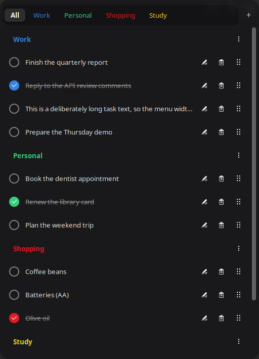

# Todo MD

A GNOME Shell todo extension that keeps your tasks in a plain **markdown
checkbox** file (`~/todo.md` by default) and shows them in the panel menu. No
database, no proprietary format, no cloud — the file stays readable in any
editor, on any device.



Compatible with GNOME Shell 46, 47, 48, 49 and 50 — each release was verified by
the same manual regression run in its own VM (Ubuntu 24.04, 24.10, 25.04, 25.10,
26.04), on Wayland. Written in JavaScript (ESModules, GJS).

> **Status:** Todo MD is in review on extensions.gnome.org. Until it is published
> there, GitHub is the only install and update path — see [Install](#install).

## Why Todo MD?

- **The file is already a todo list everywhere else.** Markdown checkboxes render
  as real checkboxes in Obsidian, VS Code, GitHub, Logseq and most note apps, so
  the same file works as a checklist with or without this extension — nothing to
  export, nothing to convert if you stop using it.
- **A flat format instead of a format with a manual.** `todo.txt` wants its own
  syntax for priority, projects and contexts (`(A)`, `+project`, `@context`) and
  a tool that speaks it; its GNOME extensions are unmaintained and pinned to
  Shell ≤ 45. Here there are two things to learn — `- [ ]` and `## Heading` — and
  any markdown editor already knows both.
- **The extension is a view, not a vault.** No sync, no import/export, no
  database. Edit the file in vim, with `sed`, in Syncthing, in git or on your
  phone: a `Gio.FileMonitor` picks the change up live and the menu refreshes.
- **Every rewrite is safe.** Notes, blank lines, comments and any other
  non-task line survive verbatim, line endings are preserved, and only three
  normalizations are deliberate (see
  [Deliberate normalizations](#deliberate-normalizations)) — so the diff after
  an action is exactly the action. The file is safe in git or in a synced
  folder.
- **Categories are structure, not decoration.** `##` headings become colored
  tabs with their own add / rename / recolor / delete actions; renaming carries
  the color over, deleting drops it, and neither touches a task line.
- **Written for the Wayland-only era, and kept alive.** GNOME 49 removed X11 and
  GNOME 50 removed it entirely, which leaves a lot of todo extensions on APIs
  that no longer exist. Todo MD is regression-tested on every Shell release it
  declares and developed in the open.
- **Tiny footprint.** One markdown file plus its own GSettings schema: no
  network requests, no daemon, no subprocesses, no clipboard use.
- **Panel-native behaviour.** A fixed menu width (the frame never jumps), a
  configurable height with scroll positions that survive every action,
  drag-and-drop ordering with Alt+Up / Alt+Down as the keyboard path, and inline
  editing without leaving the menu.

## Features

- Panel indicator with a popup menu listing the tasks from your file
- **Tabs**: a permanent, horizontally scrollable strip (`All` plus one tab per
  category) that filters the menu. The tabs carry the category color, the scroll
  position survives every rebuild, and the mouse wheel scrolls the strip
  anywhere. A **`+` at the far right** creates a new category (auto-colored from
  the palette, in order, wrapping around)
- **Category action menu**: every header has a **⋮** button — also reachable by
  right-clicking a tab or a header row — with `Add task`, `Change color`,
  `Rename` and `Delete`; delete asks for confirmation on a second click
- **Category colors**: `Change color` opens a palette in the panel itself (with a
  no-color swatch to clear it); the preferences window gives every category a
  free color dialog and a quick-palette menu with a `None` entry. Both write the
  same setting, changes apply to the menu instantly, and dead entries are pruned
  automatically
- **Categories**: `## Category` headings render as non-clickable headers that
  group the tasks under them — every header, empty ones included, has a **`+`**
  button that opens an inline entry to add a task right there; a file without
  headings starts with an implicit `General` section
- **Checkbox column**: every row starts with a fixed-width circle — filled with
  the category color and checked when the task is done — so checking a task can
  never widen the menu
- **Scrollable menu**: content taller than the configured limit scrolls while
  the tab bar stays fixed; both scroll positions survive every action, including
  category switches
- **Reordering**: drag the grip handle at the end of a row to move a task inside
  its category, or focus a row and press Alt+Up / Alt+Down
- **Fixed menu width**: the frame never widens or shrinks with the content; long
  texts truncate with an ellipsis
- Inline editing (Enter saves), delete, check/uncheck by clicking the row
- Completed tasks get a strikethrough and faded text
- **Live reload**: edits made outside the Shell (vim, atomic writes, anything)
  are picked up instantly

## Install

Todo MD is under review on extensions.gnome.org, so GitHub is currently the only
install and update path.

### Zip install

```bash
git clone https://github.com/ErtugrulSefaL/gnome-todo-md
cd gnome-todo-md
bash tools/make-package.sh
gnome-extensions install dist/todo-md@ertugrulsefal.github.com-<version>.zip
```

Log out and back in (the Shell scans the extension directory at startup), then:

```bash
gnome-extensions enable todo-md@ertugrulsefal.github.com
gnome-extensions info todo-md@ertugrulsefal.github.com   # State: ACTIVE
```

Installing from a zip compiles the GSettings schema for you.

### Update

```bash
cd gnome-todo-md
git pull
bash tools/make-package.sh && gnome-extensions install --force dist/todo-md@ertugrulsefal.github.com-<version>.zip
```
Log out and back in, then enable it as above.

> [!NOTE]
> Once the review finishes, updates come from extensions.gnome.org instead; GitHub stays the place for unreleased changes.

## Settings

```bash
gnome-extensions prefs todo-md@ertugrulsefal.github.com
```

(Or: Extensions app → Todo MD → the gear icon.)

| Setting | Default | Range | Notes |
|---|---|---|---|
| Todo file path | `~/todo.md` | — | An empty value means the default; `~` and `~/` are expanded to your home directory. The file is watched live, and changing the path re-wires the watcher immediately — no Shell reload needed |
| Menu width | 500 px | 300–2000 | Fixed frame width; long task texts truncate with an ellipsis and the tab bar scrolls horizontally past it |
| Max menu height | 400 px | 200–2000 | Height of the scrollable content area |
| Category colors | empty | — | Category name → CSS color; edited from the preferences window or from the panel menu |

## The file format

```markdown
# My TODOs

## General

- [ ] buy milk
- [x] already done

## Work

- [ ] report
```

Anything that is not a `##` heading or a checkbox line (notes, blank lines,
plain list items, other markers) is preserved verbatim on every rewrite — the
file stays hand-editable.

### Deliberate normalizations

Three small rewrites happen when the extension writes the file. They are
intentional, and everything else round-trips byte-for-byte:

| Written as | If you wrote | Why |
|---|---|---|
| `[x]` | `[X]` | one canonical spelling of "done" |
| `## Name` | `##Name` | the space is required by the format |
| `- [ ] text` | `-  [ ]  text` | canonical task prefix |

Line endings are **not** one of them: a file with Windows line endings is
written back with Windows line endings, so editing it through WSL or a Windows
editor does not produce a whole-file diff.

## Data & privacy

Todo MD reads and writes exactly one file — the markdown todo file you configure
— plus its own GSettings schema. There are no network requests, no
subprocesses and no clipboard use. Writes are atomic (`Gio.File.replace_contents`,
temp file + rename), and the `Gio.FileMonitor` on the file recognises the
extension's own writes so they do not trigger a second rebuild.

Like most panel extensions, Todo MD builds on GNOME Shell's internal JavaScript
modules (panel menu, popup menu, drag-and-drop) and on St/Clutter. Those are not
a stable public API, which is why `shell-version` lists only the releases this
code has actually been regression-tested on.

## Development

```bash
# storage logic — no GNOME Shell needed
gjs -m tests/run_tests.mjs

# extension state check (after a UI change and a Shell restart)
./tests/smoke.sh
```

The test suite exercises `storage.js` against a temporary file; it never reads
or writes your `~/todo.md`, and it verifies that at teardown. CI runs the same
suite (plus a strict `glib-compile-schemas` and `node --check` on every module)
on every push.

All state-changing logic lives in `storage.js` as pure functions returning the
new document text, which is what the unit tests cover. Layout and interaction
(`extension.js`, `rowFactory.js`, `tabBar.js`, `prefs.js`) is verified by hand —
see the manual checklists in the repository.

## Planned

- [ ] Category drag-and-drop (reorder the tab bar)
- [ ] Tags in the UI (add and remove `@key(value)` without editing the task text)
- [ ] Date tags (`@due`, `@start`) with badges, and reminders built on them
- [ ] Notifications and archiving

## File layout

| Path | Purpose |
|---|---|
| `todo-md@ertugrulsefal.github.com/extension.js` | Lifecycle, menu, interaction state |
| `todo-md@ertugrulsefal.github.com/storage.js` | Pure functions: parse, mutate, serialize `~/todo.md` |
| `todo-md@ertugrulsefal.github.com/tabBar.js` | The persistent category tab strip |
| `todo-md@ertugrulsefal.github.com/rowFactory.js` | Row builders (task rows, inline add/edit) |
| `todo-md@ertugrulsefal.github.com/prefs.js` | GTK preferences window |
| `todo-md@ertugrulsefal.github.com/stylesheet.css` | Menu styling |
| `todo-md@ertugrulsefal.github.com/metadata.json` | Extension metadata (shell-version 46–50) |
| `todo-md@ertugrulsefal.github.com/schemas/` | GSettings schema |
| `tests/run_tests.mjs` | Unit/integration tests for `storage.js` (run with `gjs`) |
| `tests/smoke.sh` | Check the extension is `State: ACTIVE` |
| `tools/make-package.sh` | Build the installable zip |
| `tools/shell-api.sh` | Probe the installed Shell for every API the extension uses |
| `docs/verified-apis.md` | API → source → verdict evidence log |
| `docs/screenshots/` | Screenshots, named after the version they show |

## License

GPL-3.0 — see `LICENSE`.
